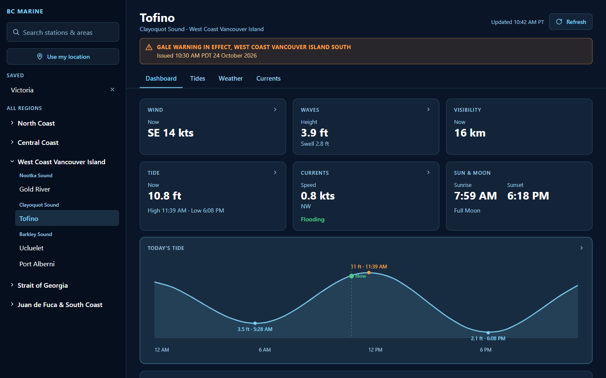
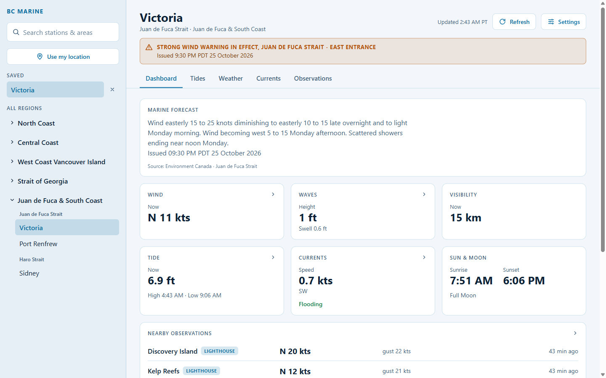
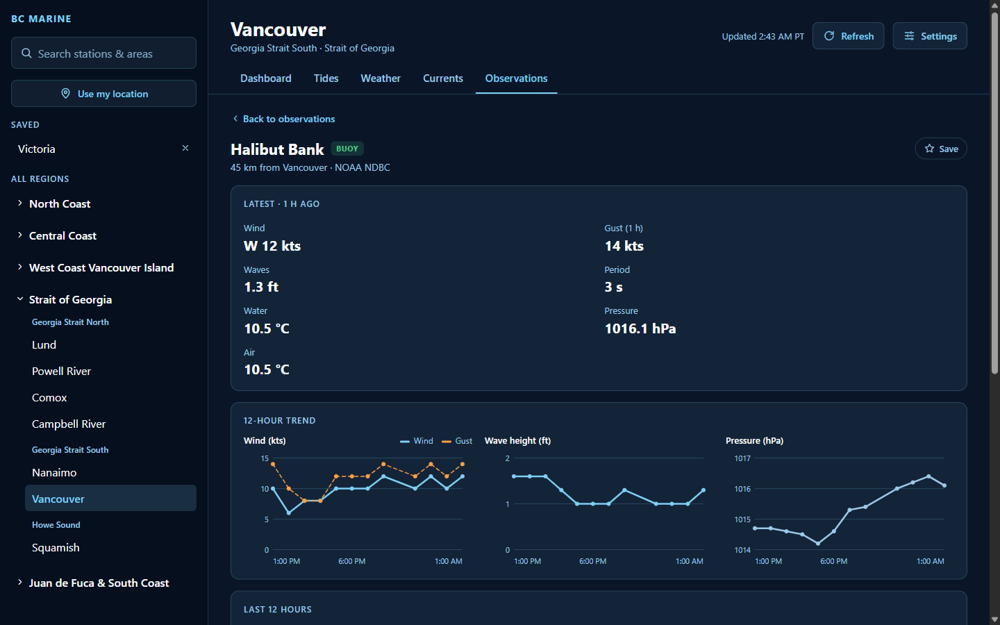
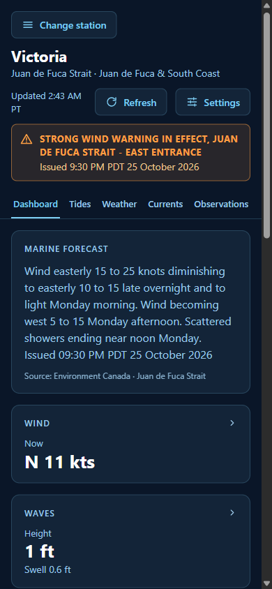
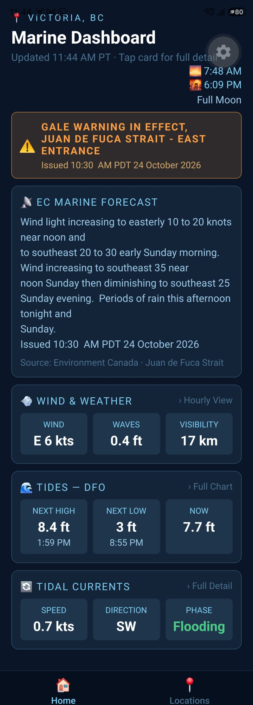
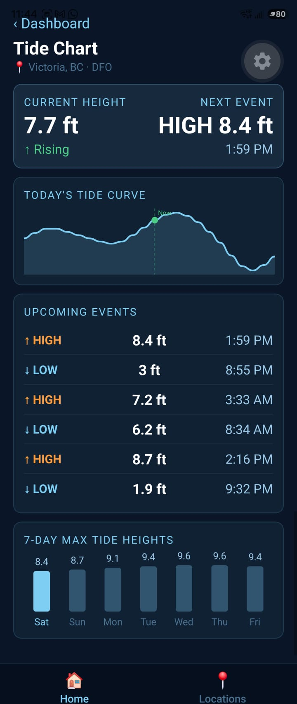
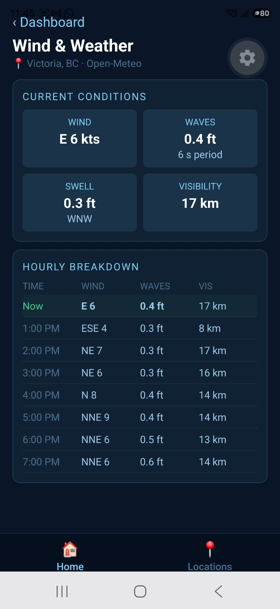

# BC Marine

Live tides, wind, waves, currents and Environment Canada marine forecasts for the British Columbia coast, on the web and on your phone.

[](https://github.com/Cory71/bc-marine/actions/workflows/ci.yml)

**Live demo: [bc-marine.vercel.app](https://bc-marine.vercel.app)** (no install, works on desktop and phone browsers)

## Screenshots

### Web (desktop)



The theme follows your device (light or dark), or can be set in Settings:



Each lighthouse and buoy has its own page with 12-hour charts:



### Web (phone browser)



### Mobile app (Expo)

<p>
  
  
  
</p>

## Features

- **Dashboard**: wind, waves, visibility, tide, tidal currents and sun/moon for the active station, plus today's tide curve and the full EC marine forecast
- **Tides**: current height and trend, next high/low, today's curve, upcoming events and a 7-day max tide chart
- **Wind & Weather**: 16-point compass headings, wave height and period, swell, visibility and an 8-hour breakdown
- **Tidal Currents**: speed, direction and flooding/ebbing phase
- **Locations**: search by name or weather area, browse by EC marine region, save favourites, or use your location to find the nearest station. Covers all 17 of Environment Canada's BC marine forecast areas, including the offshore Bowie, Explorer and Queen Charlotte Sound (forecast and weather only, no tides). Each station gets its own part of split areas, like the east, central or west part of Juan de Fuca Strait
- **Nearby observations**: live wind, gusts, waves, pressure and temperatures from the nearest lighthouse weather stations and ocean buoys on the same part of the coast, with how fresh each reading is. Each lighthouse and buoy has its own page with charts and a table of the last 12 hours (wind and gusts, wave height for buoys, and pressure), can be found by search, and can be starred to keep it in a "Saved lighthouses & buoys" list on this device
- **Marine warnings**: active EC warnings shown at the top of every screen, most severe first, with gale and above in red
- **Settings** (top of every screen, remembered on that device until changed): pick the station the app opens with; a light or dark theme (or follow the device, the default); and your units: knots, km/h or mph; feet or metres; °C or °F; km or nautical miles; and pressure in hPa (mb), kPa or inHg
- **Web extras**: shareable links (`/tides?station=tofino`), a desktop layout with a station sidebar, keyboard navigation and screen-reader labels

## Data Sources

| Source                                     | What it provides                               |
| ------------------------------------------ | ---------------------------------------------- |
| Fisheries and Oceans Canada (DFO IWLS API) | Tide heights, high/low events, 7-day forecast  |
| Open-Meteo Marine and Forecast APIs        | Wind, waves, swell, tidal currents, visibility |
| Environment Canada Atom feeds              | Marine warnings and text forecasts             |
| Environment Canada GeoMet (SWOB)           | Live lighthouse and headland weather stations  |
| NOAA National Data Buoy Center             | Live readings from EC's BC ocean buoys         |

No API keys are required. All of these services are free and open.

## Architecture

One npm-workspaces monorepo with two apps and a shared package:

```text
bc-marine/
├── apps/
│   ├── mobile/        Expo / React Native app (iOS and Android)
│   └── web/           Vite + React single-page app, deployed on Vercel
│       └── api/       One serverless function: the Environment Canada feed proxy
└── packages/
    └── shared/        Plain-JS data layer used by both apps: API services,
                       caching, BC-time helpers, station list, reading helpers
```

- **Shared data layer:** both apps import the same services, so a fix to an API call or a unit conversion reaches web and mobile at once.
- **One small proxy:** DFO and Open-Meteo allow browser requests, but Environment Canada's feeds don't, so the web app fetches them through a tiny Vercel function that only accepts known feed codes.
- **BC time everywhere:** times are shown in Pacific time whatever the viewer's own time zone.

The design reasoning is in [docs/architecture.md](docs/architecture.md).

## Tech Stack

- **Shared:** JavaScript (ES modules) · built-in `fetch` · fast-xml-parser · SunCalc
- **Web:** React 19 · Vite · React Router · hand-built SVG charts and CSS (no UI or chart libraries) · Vercel Functions
- **Mobile:** Expo SDK 58 · React Native · React Navigation · AsyncStorage · react-native-svg · expo-location
- **Quality:** Vitest · Testing Library · ESLint · Prettier · GitHub Actions · Lighthouse (desktop: Performance 98+, Accessibility 100)

## Running Locally

Requires [Node.js](https://nodejs.org/) 20 or newer.

```bash
git clone https://github.com/Cory71/bc-marine.git
cd bc-marine
npm install                              # installs every workspace
```

### Web app

```bash
npm run dev --workspace bc-marine-web    # opens at http://localhost:5173
```

### Mobile app (on your phone, with Expo Go)

1. Install **Expo Go** from the App Store or Google Play, and make sure it's up to date (the app uses Expo SDK 58).
2. Connect your phone to the same Wi-Fi as your computer.
3. Start the app, then scan the QR code: on Android with Expo Go's **Scan QR code**, on iPhone with the **Camera** app.

```bash
npm start --workspace bc-marine-mobile
npm start --workspace bc-marine-mobile -- --clear    # after pulling new changes
npm start --workspace bc-marine-mobile -- --tunnel   # if the phone is on a different network
```

For **Use my location**, turn on **Precise location** for Expo Go. More tips are in [apps/mobile/README.md](apps/mobile/README.md); the web app's notes are in [apps/web/README.md](apps/web/README.md).

## Testing and CI

```bash
npm test        # Vitest: shared package and web app
npm run lint    # ESLint
```

Tests cover unit conversions, BC-time and daylight-saving edge cases, EC feed parsing (Atom, RSS and shared-feed sub-areas), cache expiry, partial API failures, the proxy's allowlist, the web data context and the tide chart. GitHub Actions runs lint, tests, the web build and a mobile bundle check on every push and pull request.

## Known Limitations

- **Tidal currents:** Open-Meteo has no current data for fjords, inlets and many sheltered waters, so stations like Gold River show a "no data" message.
- **BC's permanent UTC−7:** BC stops changing its clocks on November 1, 2026. Devices with older time zone data may show times one hour off after that date. See [docs/architecture.md](docs/architecture.md#bc-time).

## How This Was Built

I designed BC Marine and wrote the design spec and the step-by-step build plan, including the key decisions: one shared data package, Vercel for hosting, JavaScript over TypeScript, BC time handled in shared code, and an allowlisted proxy for Environment Canada. The plan was carried out task by task with an AI coding assistant (Claude Code), with tests written before each feature, every change checked in a real browser or on a phone, and CI on every push. I reviewed each step and own the design, the decisions and the result.

## Project Planning

Development tracked on the [BC Marine project board](https://github.com/users/Cory71/projects/5).
